# Darkviews

Darkviews cria vídeos para YouTube no seu próprio computador. Você descreve o vídeo, pode mandar um vídeo de referência e as suas fotos, e o sistema entrega o vídeo pronto: roteiro, imagens, narração, títulos de capítulo e efeitos. Depois você ajusta tudo num editor e gera os cortes verticais para Shorts, Reels, TikTok e Stories.

Tudo roda na sua máquina, em `http://localhost:5173`. O roteiro e as escolhas de imagem são feitos pelo Claude, com a sua conta.

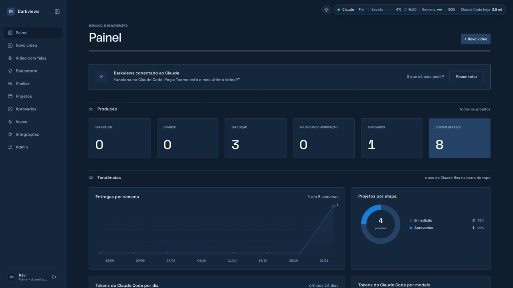

## Como funciona, em 4 passos

1. **Tenha a ideia:** escreva o seu nicho no **Brainstorm** ou cole um vídeo que você gosta em **Análise**.
2. **Crie o vídeo:** em **Novo vídeo** (ou **Vídeo com falas**), diga o assunto, a duração e a voz. O sistema faz o resto.
3. **Ajuste:** no editor, troque cenas, legendas, áudio e títulos, ou só escreva o que quer mudar.
4. **Publique:** aprove, baixe o vídeo e os cortes verticais prontos.

## As telas

### Painel
Quantos vídeos estão em cada etapa, entregas por semana e quanto do Claude você já usou. No topo de todas as telas aparece o uso da sessão e da semana do Claude.

Com o Darkviews ligado, você também pode pedir pelo Claude Code coisas como "como estão os meus vídeos?", "cria um vídeo sobre…" ou "muda a cena 3". O botão **O que dá para pedir** mostra exemplos.

### Brainstorm
Escreva o seu nicho e o Claude sugere ideias de vídeo, com a frase de abertura e os tópicos do roteiro. Cada ideia vira um **Novo vídeo** ou um **Vídeo com falas** com um clique.

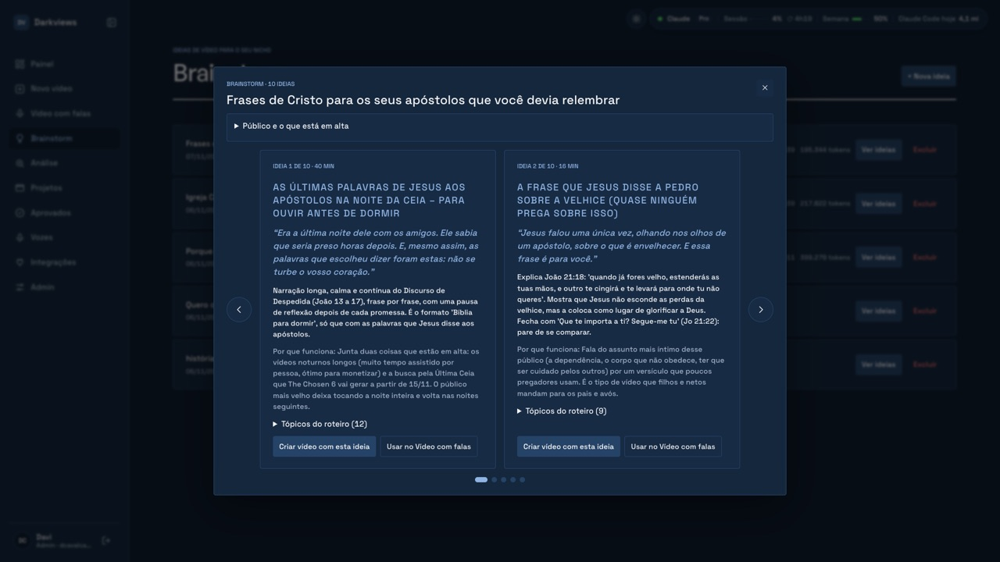

### Análise
Cole o link de um vídeo (YouTube, Instagram, Kwai ou TikTok) e o sistema explica o que ele faz: ritmo, cenas e estilo. A análise pode virar referência de um vídeo novo.

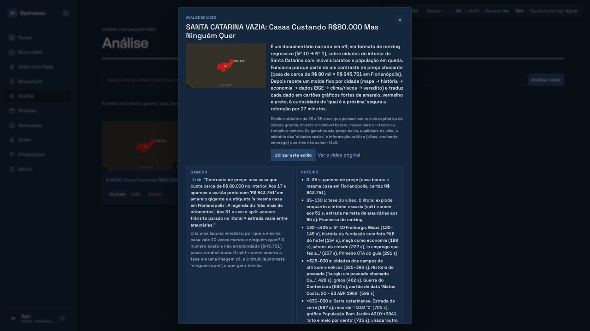

### Novo vídeo
Prompt, duração, link ou vídeo de referência, suas fotos (com uma legenda curta para cada), voz e estilo de edição.

- **Mídia:** imagens e vídeos, só imagens ou só vídeos. Em "Só vídeos" você pode enviar vídeos longos: o sistema corta trechos, você aprova, e os reprovados são trocados por cortes novos ou pelos aprovados repetidos.
- **Criação automática:** analisa a referência, escreve o roteiro, busca imagens nos bancos gratuitos (ou usa só as suas), narra e monta o vídeo em 1920×1080.
- **Aprovação das imagens** antes da narração: recuse as que não gostar e o sistema busca outras. Sem resposta em 10 minutos, elas são aprovadas sozinhas.
- **Uma voz só:** a voz escolhida narra o vídeo inteiro e cada fala é conferida pelo Whisper; se sair pouco clara, é gerada de novo.
- **Vídeos de até 60 minutos**, montados em blocos, com o progresso na tela. Qualquer vídeo em andamento pode ser **cancelado**.

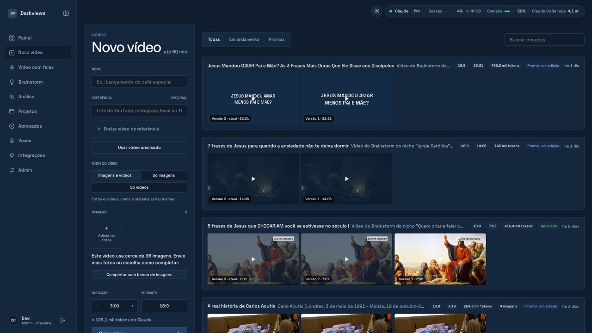

### Vídeo com falas (em teste)
Para vídeos com frases exatas de alguém (por exemplo, frases de Jesus numa série). O Claude escreve o roteiro e marca cada fala; você envia o vídeo longo e o corte de cada fala. No vídeo, o locutor anuncia a fala, entra o corte com o áudio original e o locutor volta explicando. Cada etapa só segue quando você clica em **Continuar**.

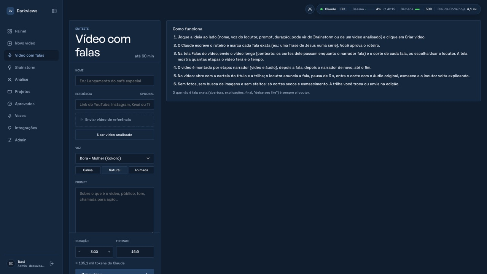

### Editor
Parecido com um programa de edição: prévia do vídeo e linha do tempo com cenas, legenda, narração, trilha e efeitos. Tudo fica em rascunho até você clicar em **Salvar** e **Renderizar vídeo**.

- **Cena:** movimento da foto (Ken Burns, parallax, recorte, zoom rápido) e transição.
- **Áudio:** narração de cada cena, trilha sonora e volumes.
- **Legenda:** estilos prontos, edição linha por linha e destaque de palavras.
- **Enunciado:** os títulos de cada etapa, com um estilo que vale para todos.

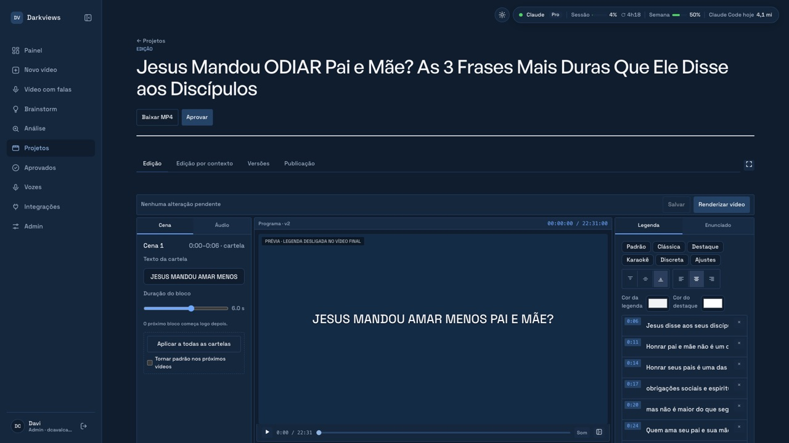

**Edição por contexto:** assista, pause e escreva o que mudar naquele momento. No fim, o Claude refaz o vídeo com todos os pedidos.

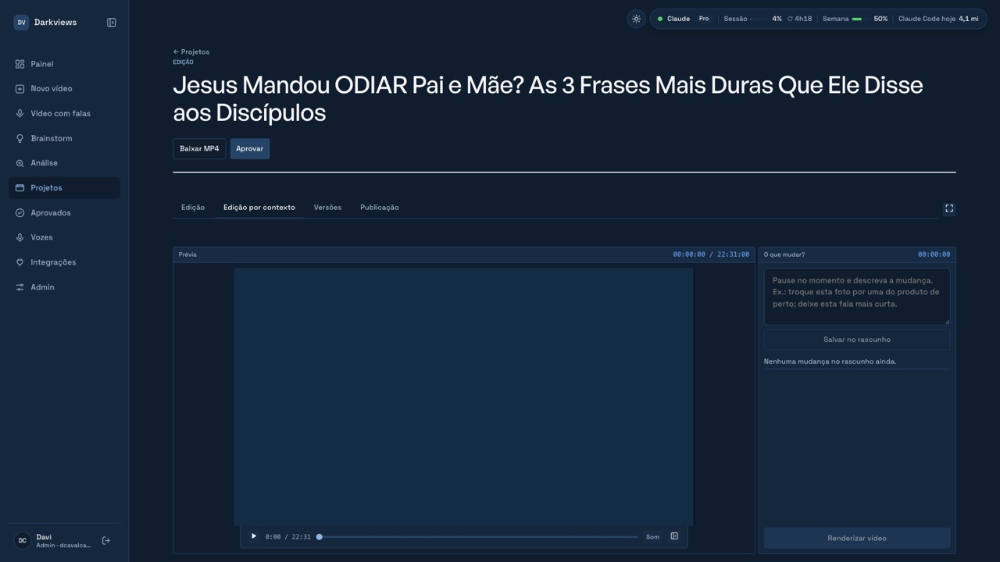

**Versões** mostra o que mudou de uma versão para outra. **Publicação** reúne título, descrição, palavras-chave e thumbnail.

| Versões | Publicação |
| --- | --- |
| 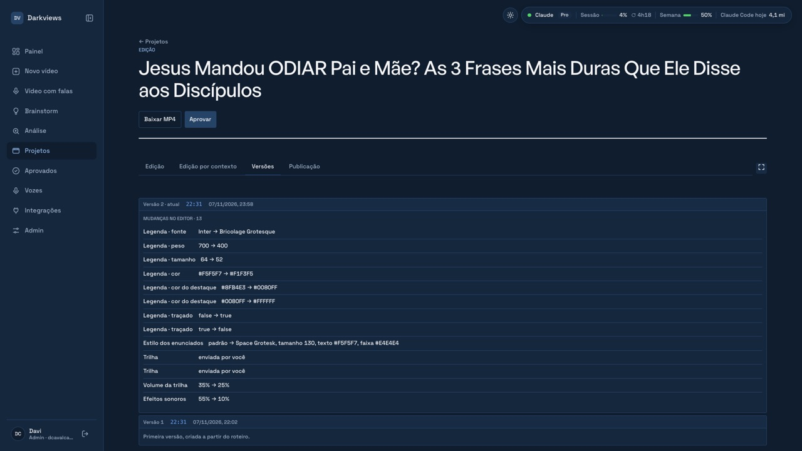 | 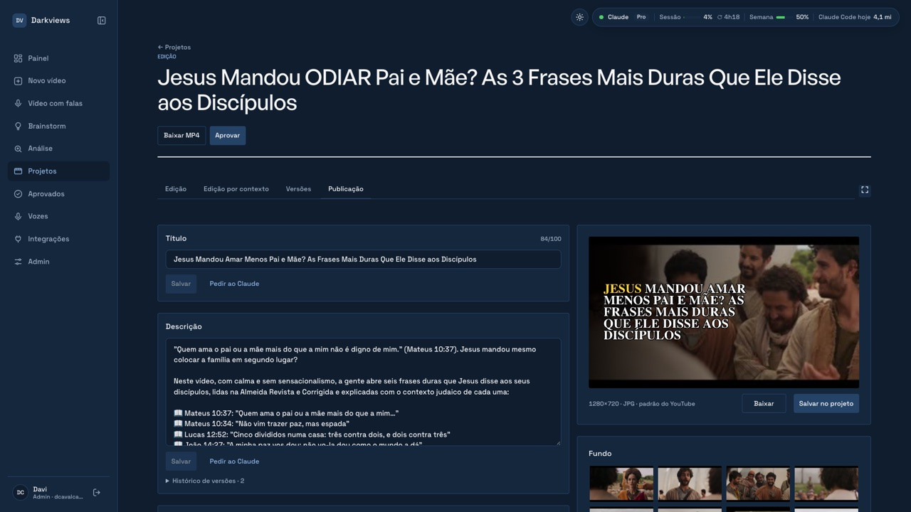 |

### Aprovar e cortes verticais
Escolha o trecho e o enquadramento e o sistema gera os cortes 9:16 para cada plataforma. Os vídeos aprovados ficam em **Aprovados**, com os cortes prontos para baixar.

| Aprovar | Cortes prontos |
| --- | --- |
| 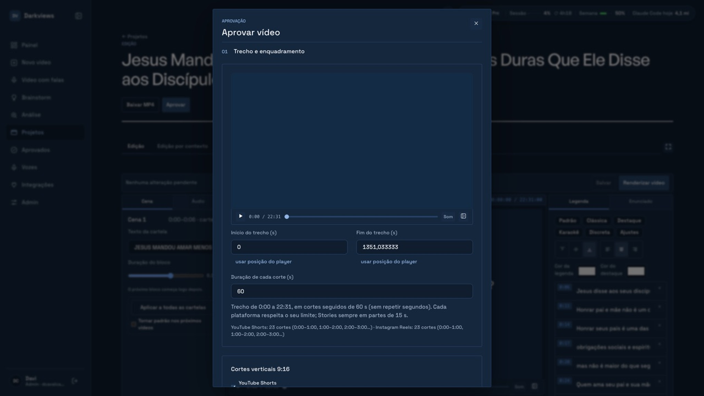 | 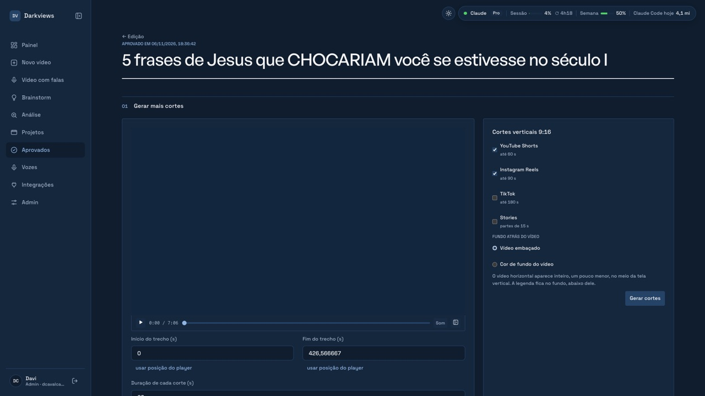 |

### Vozes, Integrações e Admin
- **Vozes:** crie uma voz por características ou **clone a sua própria voz** (gravando ou enviando um áudio).
- **Integrações:** bancos de imagem, vozes e músicas, gratuitos ou com a sua chave.
- **Admin:** perfil, **Identidade** (o visual padrão das cartelas, legendas e enunciados, com prévia), fontes, auditoria e logs ao vivo.

| Vozes | Integrações | Identidade |
| --- | --- | --- |
| 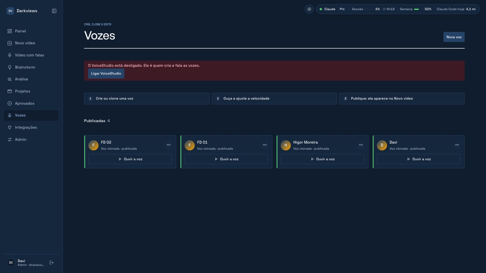 | 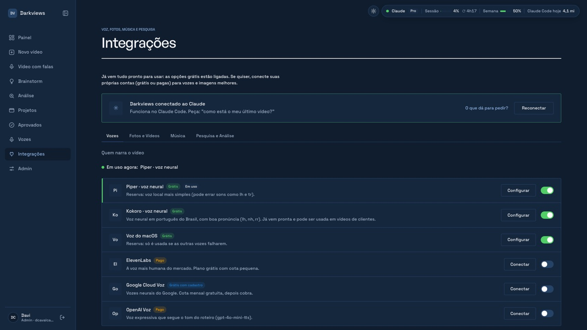 | 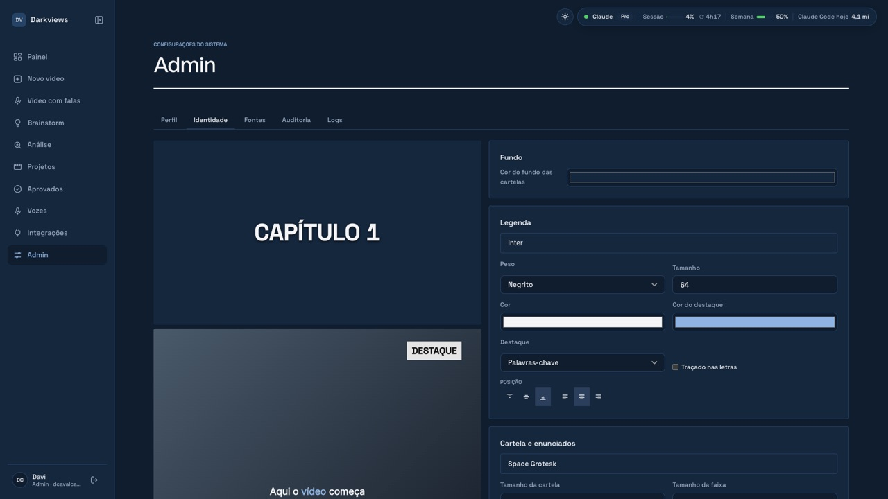 |

## Instalar

Em todos os sistemas você precisa de internet, uns **15 GB livres** e uma conta do Claude (Pro ou Max). A primeira instalação leva de 20 a 40 minutos.

| Sistema | Como instalar |
| --- | --- |
| **Mac com chip Apple (M1 ou mais novo)** | Instalador automático, dois cliques. Recomendado. |
| **Windows 10 ou 11** | Pelo WSL (um Linux dentro do Windows), passo a passo abaixo. |
| **Linux (Ubuntu/Debian)** | Passo a passo abaixo. |

> O instalador automático e o VoiceStudio (clonar a sua voz) só existem para Mac. No Windows e no Linux o resto do sistema funciona, mas essa instalação não foi testada como a do Mac.

### Mac

1. Baixe o projeto: no GitHub, botão verde **Code → Download ZIP**, e descompacte. Ou, no terminal:
   ```bash
   git clone https://github.com/davicavalcante-co/darkviews.git
   ```
2. Dê **dois cliques** em `Instalar Darkviews`.
   - Se o Mac avisar que é de fonte desconhecida: botão direito → **Abrir** → **Abrir**.
   - Se pedir a senha do Mac, digite (é o Homebrew instalando os programas).
   - Se abrir uma janela da Apple pedindo para instalar ferramentas, aceite e, quando terminar, dê dois cliques no instalador de novo.
3. No fim, abre o **login do Claude**: entre com a sua conta.
4. Anote o **token de primeiro acesso** que aparece no final.

O instalador pode ser rodado de novo quando quiser: o que já está instalado é pulado.

### Windows

1. Abra o **PowerShell como administrador** e instale o WSL (depois reinicie o computador):
   ```powershell
   wsl --install -d Ubuntu
   ```
2. Abra o **Ubuntu** pelo menu Iniciar, crie o usuário e a senha que ele pedir e siga os passos do **Linux** abaixo dentro dessa janela.
3. Depois de ligado, abra `http://localhost:5173` no navegador do Windows normalmente.

### Linux (Ubuntu/Debian)

Rode no terminal, um bloco por vez:

1. Programas do sistema:
   ```bash
   sudo apt update && sudo apt install -y git curl ffmpeg python3 python3-venv yt-dlp build-essential
   ```
2. Node 22, pnpm, uv e Claude Code:
   ```bash
   curl -fsSL https://deb.nodesource.com/setup_22.x | sudo -E bash - && sudo apt install -y nodejs
   ```
   ```bash
   sudo npm install -g pnpm @anthropic-ai/claude-code && curl -LsSf https://astral.sh/uv/install.sh | sh
   ```
3. Baixe o projeto e as dependências:
   ```bash
   git clone https://github.com/davicavalcante-co/darkviews.git && cd darkviews && pnpm install
   ```
4. Configuração e banco de dados (anote o **token de primeiro acesso** que aparece):
   ```bash
   cp .env.example .env && sed -i "s/^MASTER_KEY=\"\"/MASTER_KEY=\"$(openssl rand -hex 32)\"/" .env && pnpm run db:setup
   ```
5. Vozes locais (Kokoro e Piper):
   ```bash
   uv venv --python 3.11 .venv-kokoro && uv pip install --python .venv-kokoro/bin/python kokoro soundfile && uv venv --python 3.11 .venv-tts && uv pip install --python .venv-tts/bin/python piper-tts
   ```
6. Login do Claude:
   ```bash
   claude auth login
   ```

Opcional: para conferir a narração com o Whisper, instale o `whisper.cpp`, baixe o modelo `ggml-small.bin` e coloque o caminho dele em `WHISPER_MODEL` no `.env`.

## Usar no dia a dia

1. **Mac:** dê **dois cliques** em `Ligar Darkviews`; o navegador abre sozinho. **Windows e Linux:** na pasta do projeto, rode `pnpm dev` e abra `http://localhost:5173`.
2. **Só na primeira vez:** na tela de login, aba **Primeiro acesso**, cole o token e clique em **Entrar com o token**. Dentro do sistema abre uma janela para você definir o seu nome, e-mail e senha. Daí em diante, entre normalmente com eles. O sistema começa vazio, só com a sua conta.
3. Para desligar, feche a janela do terminal que abriu.

Para usar vozes próprias (aba **Vozes**, só no Mac): clique em **Ligar VoiceStudio** e, na primeira vez, em **Aceitar licença do modelo**. A primeira voz do dia demora uns 5 minutos para carregar.

## Se algo der errado

| O que aparece | O que fazer |
| --- | --- |
| "Faça login no Claude Code" | Abra o terminal, rode `claude` e use `/login`. Os vídeos pausados continuam sozinhos. |
| Limite do Claude atingido | O vídeo pausa e continua sozinho no horário em que o limite renova. |
| "O VoiceStudio está desligado" | Aba **Vozes → Ligar VoiceStudio**. |
| Narração com voz própria lenta | É normal: cada cena leva de 10 a 25 s. O andamento mostra "cena X de Y" e o tempo que falta. Feche outros programas se o Mac estiver com pouca memória. |
| "A voz escolhida está desligada" | Ligue a voz de novo em **Integrações** ou escolha outra no editor. O vídeo nunca troca de voz sozinho. |
| Vídeo parou com erro | Abra o projeto e clique em **Tentar de novo**: só a etapa que falhou é refeita. |
| A porta 3333 ou 5173 está em uso | Já tem um Darkviews ligado. Feche a outra janela do terminal e ligue de novo. |
| Legendas não aparecem no vídeo (Linux/Windows) | O FFmpeg instalado precisa ter suporte a legendas (`libass`). O do `apt` já tem. |

## O que fica onde

| Pasta | O que é |
| --- | --- |
| `data/app.db` | Banco de dados (projetos, usuários, versões). |
| `storage/projetos/` | **Todo o material de cada vídeo numa pasta só**, com o nome do vídeo: `envios` (suas fotos e vídeos), `referencia`, `midia` (fotos e vídeos dos bancos, trilha), `narracao`, `videos` (versões renderizadas), `quadros`, `cortes-dos-envios`, `cortes-verticais`, `miniaturas`. Excluir o vídeo no sistema apaga a pasta. |
| `storage/` (resto) | Coisas do sistema: análises, vozes, músicas, fontes. `sem-uso/` são sobras de vídeos já excluídos: pode apagar. |
| `.env` | Configuração e a chave que protege as senhas das integrações. **Não compartilhe.** |
| `vendor/voicestudio/` | VoiceStudio, usado na aba Vozes. |
| `docs/telas/` | As imagens deste README. |

**Backup:** copie `data/app.db` e a pasta `storage/` com o sistema desligado. Guarde o `.env` **separado**: sem ele as chaves das integrações não podem ser lidas.

## Licenças

O Darkviews conversa com o VoiceStudio (AGPL-3.0) pela rede local, sem incluir o código dele. O modelo de voz padrão do VoiceStudio é **não comercial** (CC-BY-NC): uso pessoal.

## Para quem desenvolve

- Peças: `apps/web` (site, React), `apps/api` (servidor, Fastify), `apps/worker` (cria os vídeos com FFmpeg), `apps/mcp` (conversa com o Claude), `packages/*` (banco, tipos e integrações).
- Ligar pelo terminal: `pnpm dev`. Testes: `pnpm test`.
